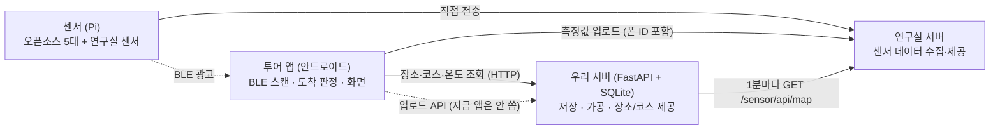
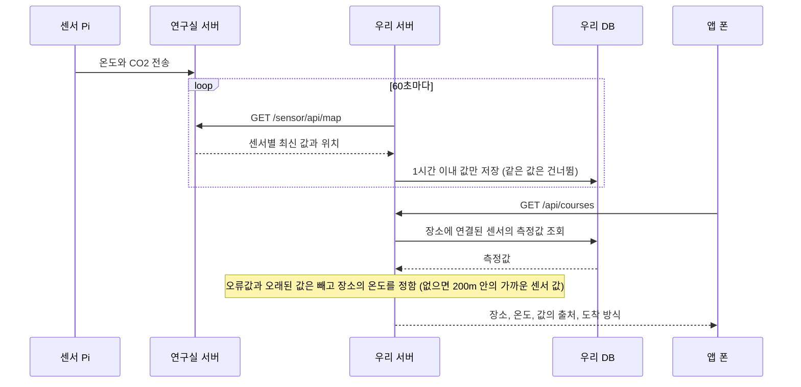
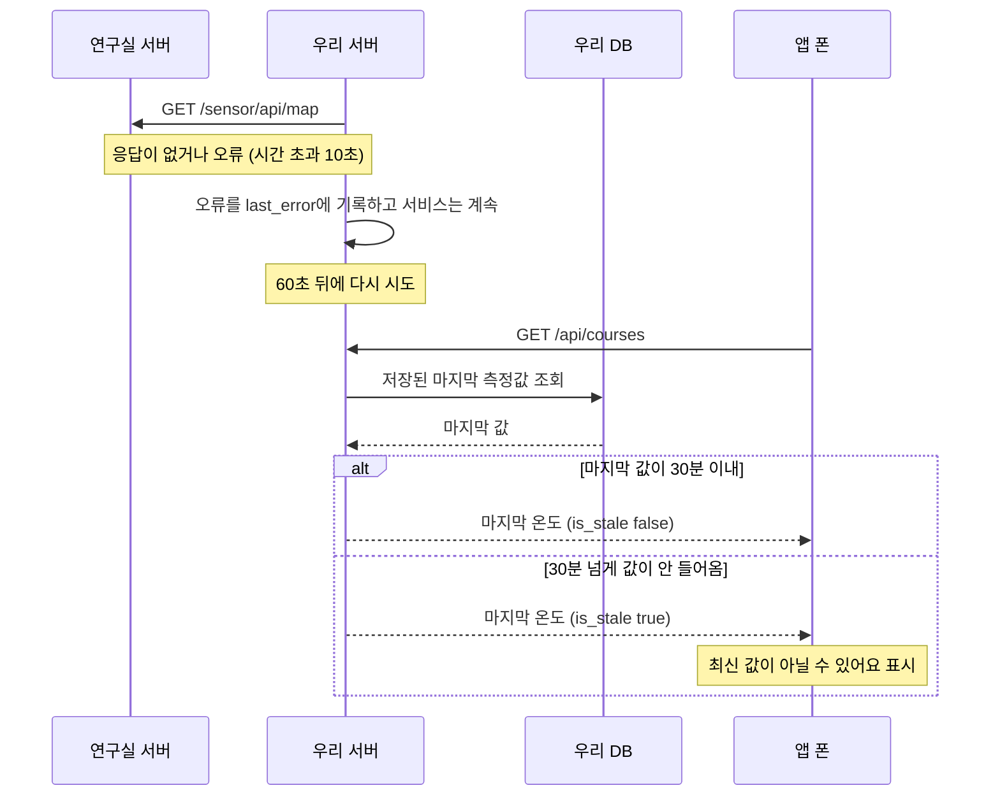
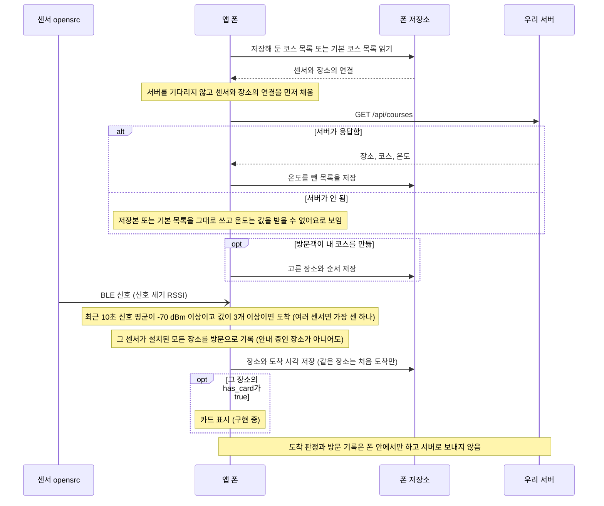
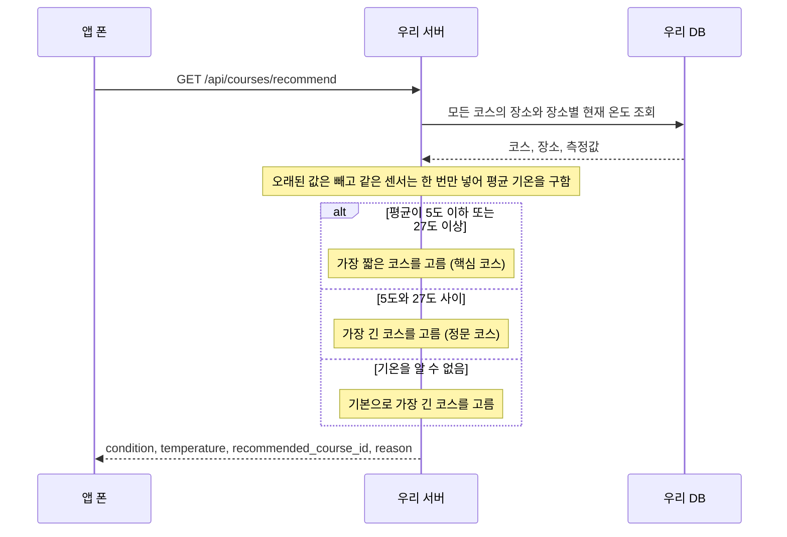
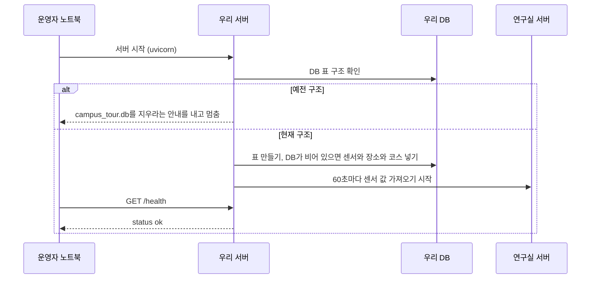
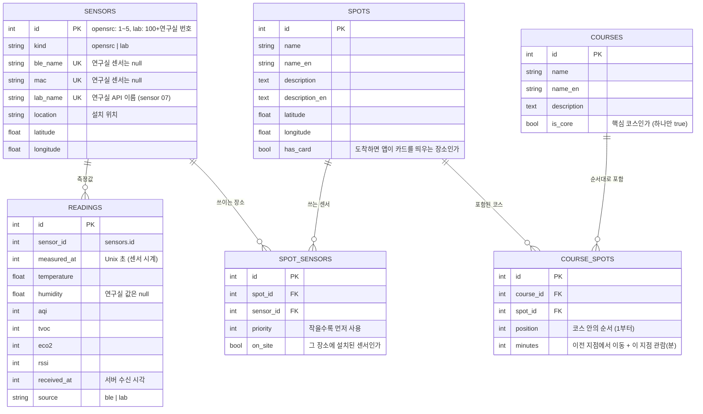
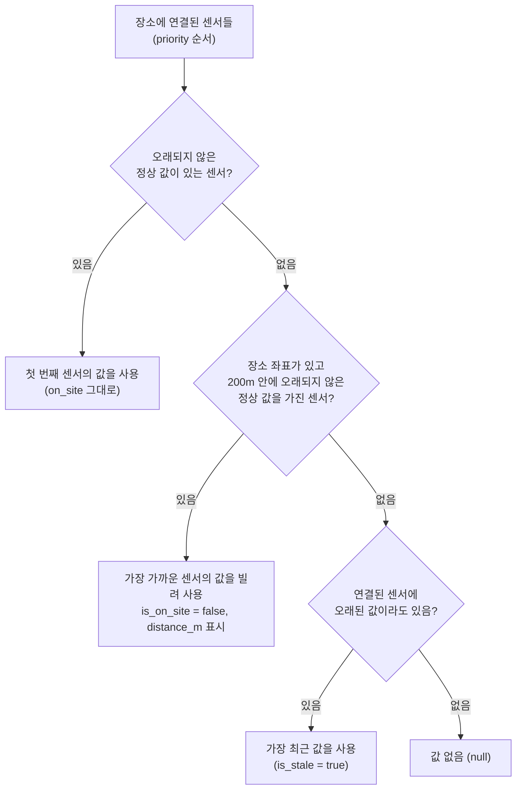

# 백엔드 설계 문서 (초안)

캠퍼스 BLE 투어 가이드 — 서버 및 DB 파트
작성 기준: 2026-11-17 / 담당: 최세원

> 이 문서는 서버(백엔드)의 구조와 API를 정리한 초안입니다. 표 구조와 장소·센서 응답 예시는 실제 코드를 돌려서 뽑았고, 장소와 코스 값은 개발용 샘플입니다. (서버가 실제로 켜질 때 넣는 투어 데이터는 `app/tour_data.py`입니다.) 연구실 동기화 결과 예시의 숫자는 설명용입니다.

## 1. 개요

### 서버가 하는 일
- 캠퍼스 센서의 **온도를 모아서 저장**하고, 오래된 값이나 오류값을 걸러서 **믿을 수 있는 값으로 가공**합니다.
- 투어 앱에 **장소와 코스 정보, 장소별 현재 온도와 출처**를 제공합니다.
- 장소의 센서가 죽어 있으면 **가까운 센서의 값을 빌려** 보여줍니다.
- 지금 기온이 춥거나 더우면 짧은 코스를, 쾌적하면 긴 코스를 **추천**합니다.

### 범위
| 포함 | 포함하지 않음 |
| --- | --- |
| 센서 값 수집(연구실 API), 저장, 가공. 측정값을 받는 업로드 API도 있음(지금 앱은 안 씀) | BLE 스캔과 도착 판정 (앱이 폰 안에서 처리) |
| 장소, 코스, 센서 정보 제공 API, 기온에 맞는 코스 추천 | 화면 (프론트엔드) |
| 센서 상태 점검 API | 방문 기록 저장 (개인정보 방침상 기기 안에만 저장) |

## 2. 시스템 구성



- **센서 데이터의 주 경로**: 센서 → 연구실 서버 → 우리 서버(1분마다 가져와 저장). 연구실 서버가 응답하지 않아도 우리 DB에 저장된 마지막 값을 보여줍니다.
- 연구실 API는 **온도(정수, 소수점 버림)와 CO2만** 주고 습도는 없습니다. 화면에는 온도만 표시합니다.
- 우리 서버에도 측정값을 받는 API(`POST /api/readings`)가 있지만 **지금 앱은 쓰지 않습니다.** 앱의 업로드는 연구실 서버로만 갑니다. 그래서 습도와 공기질은 이 API로 값을 넣은 경우에만 저장됩니다.
- **폰 ID**: 앱이 연구실 서버로 올리는 값에는 **보내는 폰의 안드로이드 ID**가 들어갑니다. (연구실 업로드 API의 `sender` 칸) 이 업로드에 폰의 위치는 들어 있지 않습니다. 아직 못 보낸 값은 폰에 파일로 두었다가 다시 보내는데, 그 파일에도 ID가 들어 있습니다. 우리 서버의 DB에는 폰 ID를 담는 칸이 없습니다. (앱의 `LabUploader`, `SensorRequest`)
- 앱은 BLE로 오픈소스 센서(`opensrc1~5`)의 신호 세기를 보고 도착을 판정합니다. 서버는 어느 센서가 어느 장소의 것인지(`arrival`)만 알려줍니다.

### 주요 흐름 (시퀀스 다이어그램)

위 구성 그림이 "어떤 부품이 어디로 이어지는가"라면, 아래 그림은 **그 연결을 따라 일이 어떤 순서로 일어나는가**입니다. 위에서 아래로 내려갈수록 나중에 일어난 일이고, 실선 화살표는 요청이나 전달, 점선 화살표는 응답입니다. 끝이 열린 화살표는 응답을 기다리지 않고 보내는 신호(BLE)입니다.

| 기능 | 나타나는 그림 | 관련 API (6장) |
| --- | --- | --- |
| 센서 값 수집, 가공, 장소별 온도 | 흐름 1 | `GET /api/spots`, `GET /api/courses`, `GET /api/sensors/status` |
| 연구실 서버가 안 될 때의 동작 | 흐름 2 | `GET /api/lab-sync/status` |
| 앱의 코스 목록 가져오기, 내 코스 만들기, 도착 판정, 방문 기록, 카드 | 흐름 3 | `GET /api/courses` |
| 환경 맞춤 코스 추천 | 흐름 4 | `GET /api/courses/recommend` |
| 서버 시작과 DB 준비 | 흐름 5 | `GET /health` |

#### 흐름 1. 센서 값 수집부터 앱 화면까지


#### 흐름 2. 연구실 서버가 안 될 때


#### 흐름 3. 앱 시작, 코스 목록, 도착과 방문 기록

- **도착과 떠남**: 신호 평균이 -80 dBm 아래로 떨어지거나 신호가 끊기면 떠난 것으로 봅니다. 도착은 떠났다가 다시 와야 새로 판정됩니다. 코스 목록을 받기 전에 도착한 센서는 보관했다가 목록을 받으면 기록합니다. (PR #54, 앱의 `ArrivalDetector`, `ArrivalRouter`)
- **내 코스** (자유 탐색): 장소를 2곳 이상 골라 누른 순서대로 걷습니다. 장소 목록은 위의 코스 목록(서버, 저장본, 기본 목록)에서 모으므로 서버가 없어도 만들 수 있습니다. 내 코스에는 장소별 시간이 없어 다음 장소까지의 시간은 보여 주지 않습니다. 고른 장소에 이미 도착 기록이 있으면 지우고 시작할지, 그대로 시작할지 묻습니다. (PR #57)
- **구현 상태 (2026-11-26)**: 코스 목록의 저장본과 기본 목록, 자동 도착 연결(PR #49, #54), 내 코스 만들기와 방문 시각의 폰 저장(PR #57)은 main에 반영됐습니다. **내 투어 화면과 도착했을 때의 카드는 구현 중**입니다(이슈 #37). 저장한 방문 기록을 모두 지우는 화면은 아직 없습니다.
- 서버가 하는 일은 `GET /api/courses`로 코스 목록을 주는 것까지입니다.

#### 흐름 4. 환경 맞춤 코스 추천


#### 흐름 5. 서버 시작


## 3. 기술 스택

| 구분 | 사용 |
| --- | --- |
| 언어 | Python 3.10 이상 |
| 웹 프레임워크 | FastAPI (자동 API 문서 `/docs` 제공), uvicorn |
| DB | SQLite (SQLAlchemy 2). `DATABASE_URL` 로 다른 DB로 바꿀 수 있음 |
| 외부 호출 | httpx (연구실 API) |
| 테스트 | pytest (96개) |

## 4. 데이터 모델 (ERD)



### 표별 설명
| 표 | 설명 | 주요 규칙 |
| --- | --- | --- |
| `sensors` | 캠퍼스 센서. 우리 팀 오픈소스 센서 5대(`opensrc`)와 연구실 센서(`lab`) | `ble_name`, `mac`, `lab_name`은 각각 유일. 연구실 센서는 연구실 API에서 위치가 있는 것을 **자동 등록** |
| `readings` | 센서 측정값 | **(`sensor_id`, `measured_at`)이 유일** → 같은 값이 다시 와도 한 번만 저장(재전송에 안전). `sensor_id`는 `sensors.id`를 가리키지만 DB 외래키 제약은 걸지 않음 |
| `spots` | 투어 장소 | `latitude`, `longitude`는 가까운 센서를 찾을 때 쓰므로 없으면 센서를 빌리지 못함. `has_card`는 도착하면 앱이 카드를 띄우는 장소 표시 |
| `spot_sensors` | 장소와 센서의 연결 (다대다) | 장소 하나가 센서를 여러 개 쓰고(우선순위 순), 센서 하나를 여러 장소가 쓸 수 있음. (`spot_id`, `sensor_id`)가 유일 |
| `courses` | 투어 코스 | `is_core`는 핵심 코스 여부. 핵심 코스는 하나만 두고, 앱의 핵심 코스 카드가 이 코스의 장소를 씀 |
| `course_spots` | 코스와 장소의 연결 (다대다) | (`course_id`, `position`)이 유일. 코스 총 소요시간은 `minutes`의 합 |

### 설계 이유
- **센서와 장소를 분리**했습니다. 센서가 죽거나 바뀌어도 장소 정보는 그대로 두고 연결만 바꿉니다. (센서 4·5를 테니스장 한 장소로 묶고, 센서가 없는 장소는 가까운 센서를 빌림)
- **측정값을 센서 기준으로 저장**합니다. 같은 센서의 값이 장소 여러 곳에서 쓰일 수 있기 때문입니다.
- **오류값도 버리지 않고 저장**합니다. 조회할 때만 걸러서, 센서 고장 원인을 나중에 확인할 수 있습니다.

## 5. 데이터 처리 규칙 (전처리)

| 규칙 | 내용 | 기본값 |
| --- | --- | --- |
| 중복 제거 | 같은 센서의 같은 `measured_at`은 한 번만 저장 | - |
| 오류값 제외 | 온도 -20~45도, 습도 0~100%를 벗어나거나 **온도와 습도가 모두 0.0**이면 저장하되 최신값·평균·고정값 판정에서 제외. 습도가 없는 값은 온도만 검사 | - |
| 오래된 값 표시 | 측정 후 기준 시간이 지나면 `is_stale`이 `true` | 30분 (`STALE_MINUTES`) |
| 고정값 의심 | BLE로 받은 값에서 최신 값과 같은 온도·습도가 **5개 이상 연속이고 10분 이상** 이어지면 `is_suspect`가 `true` (센서가 멈춘 것으로 의심). 연구실 값은 정수 온도라 적용하지 않음 | 5개, 10분 |
| 최근 평균 | 최근 30분 안의 정상 값의 평균(습도는 값이 있는 것만). 고정값 의심이면 `null` | 30분 |
| 센서 상태 | `no_data`(값 없음) > `invalid`(오류값만 옴) > `stale`(오래됨) > `suspect`(고정값 의심) > `ok` 순으로 우선 | - |

### 장소의 온도를 정하는 방법
장소마다 `latest_reading`(현재 온도)과 `value_source`(어느 센서의 값인가)를 다음 순서로 정합니다.



- 센서 4가 죽어 있으면 센서 4·5가 연결된 **테니스장은 센서 5의 값**을 씁니다.
- 센서 3이 죽어 있어서, 센서 3이 있는 **사회과학대 입구는 56m 거리의 opensrc1 값**을 빌립니다. (실제 데이터로 확인. 센서 2, 3의 설치 위치는 현장 확인 뒤 #43에서 바로잡았습니다.)
- 최대 거리 200m는 `MAX_BORROW_METERS`로 바꿀 수 있습니다. 먼 센서는 그 장소의 온도라고 보기 어려워 쓰지 않습니다.

### 연구실 센서 가져오기 (동기화)
- 서버가 켜져 있는 동안 **1분마다** 연구실 API(`GET /sensor/api/map`)를 호출합니다.
- 1시간 이내에 갱신된 값(`fresh`)만 저장하고, 위치가 있는 센서는 `sensors`에 자동 등록합니다(`sensor 18` → id 118).
- 시각은 KST 문자열(`Tue Nov 10 07:09:55 2026`)이라 Unix 초로 변환합니다.
- 연구실 서버가 응답하지 않아도 서비스는 멈추지 않고, 마지막 결과는 `GET /api/lab-sync/status`로 확인합니다.

## 6. API 명세

### 공통
- 기본 주소: `http://서버주소:8000` (예: `http://172.30.159.219:8000`). 자동 문서는 `/docs`.
- 요청과 응답은 JSON이고 문자는 UTF-8입니다.
- 시각은 모두 **Unix 초**입니다.
- 인증은 없습니다. (프로젝트 범위상 공개 API)
- 오류 응답은 `{"detail": "..."}` 형식입니다. 본문 형식이 틀리면 `422`(자세한 위치 포함)입니다.

### 앱 담당 확인 (2026-11-24, 이슈 #52)
앱 담당(황지유, 홍유진)이 필드와 동작의 뜻 22개 항목을 앱 코드(main)와 대조해 확인했습니다.

- **다르다고 답한 것은 13번(`minutes`, `total_minutes`) 하나**였습니다. 뜻은 같게 이해하고 있었지만 앱 화면 글자가 "도보 N분"이었습니다. 이동과 관람의 합이므로 앱이 "약 N분"으로 고쳤습니다. (PR #57) 걷는 길 경로의 "남은 거리, 도보 약 N분"은 실제 걷는 시간이라 그대로입니다.
- **지금 앱 화면에서 쓰지 않는 것**: `humidity`, `recent_average`, 장소 안내 화면의 `value_source.location`, 추천의 `reason`(앱 문구를 씀)과 `thresholds`, `GET /api/spots/{id}`. `has_card`는 내 코스 화면의 "카드" 표시에 씁니다. 도착했을 때 카드를 띄우는 것과 `is_core`를 쓰는 것은 카드 기능(#37)에서 할 예정입니다.
- 앱의 홈 지도 점 색 기준(27℃, 5℃)은 `thresholds`를 받아 쓰지 않고 **앱 안에 같은 값으로 들어 있습니다.**

### 한눈에 보기
| 메서드 | 경로 | 설명 | 주요 응답 코드 |
| --- | --- | --- | --- |
| GET | `/health` | 서버 상태 확인 | 200 |
| GET | `/api/spots` | 장소 목록 + 도착 방식 + 현재 온도와 출처 | 200 |
| GET | `/api/spots/{id}` | 장소 상세 | 200, 404 |
| GET | `/api/courses` | 코스 목록, 장소 순서, 총 소요시간 | 200 |
| GET | `/api/courses/recommend` | 현재 기온에 맞는 코스 추천 | 200 |
| GET | `/api/sensors` | 등록된 센서 목록 (`?kind=opensrc` 또는 `lab`) | 200 |
| GET | `/api/sensors/status` | 센서별 상태 (`?kind=`) | 200 |
| GET | `/api/lab-sync/status` | 연구실 센서 가져오기의 마지막 결과 | 200 |
| POST | `/api/readings` | BLE 측정값 업로드 (보조 경로, 지금 앱은 안 씀) | 201, 200, 404, 422 |

### GET /health
```json
{ "status": "ok" }
```

### GET /api/spots , GET /api/spots/{id}
장소와 현재 온도를 돌려줍니다. `/api/spots`는 이 객체의 배열입니다.

**응답 필드**
| 필드 | 설명 |
| --- | --- |
| `id`, `name`, `name_en`, `description`, `description_en` | 장소 정보 (영어는 없으면 `null`) |
| `latitude`, `longitude` | 장소 좌표. 모르면 `null` |
| `has_card` | 이 장소에 도착하면 앱이 카드를 띄우는지(#37). 핵심 코스의 장소는 모두 `true`이고, 개신문화관, 박물관, 야외공연장도 `true`. 핵심 코스 장소의 카드에는 "핵심 코스 N곳 중 M곳 방문"을, 그 밖의 장소는 장소 소개를 보여 주는 것은 앱이 정함 |
| `arrival.method` | `ble_auto`: 장소에 설치된 센서가 있어 BLE로 도착을 자동 판정(수동 버튼은 보조). `manual`: 센서가 없어 방문객이 "도착" 버튼으로 체크 |
| `arrival.sensors` | 도착 판정에 쓰는, 이 장소에 설치된 센서(`sensor_id`, `ble_name`, `mac`, `location`). `manual`이면 빈 목록. 앱이 스캔한 센서가 이 목록에 있으면 이 장소에 도착한 것 |
| `latest_reading` | 현재 온도. 값이 없으면 `null` |
| `latest_reading.temperature`, `humidity` | 온도(℃), 습도(%). 연구실 값은 습도가 `null`. 화면에는 온도만 표시 |
| `latest_reading.age_minutes`, `is_stale`, `is_suspect` | 측정 후 경과 시간(분), 오래된 값인가, 고정값 의심인가 |
| `recent_average` | 최근 평균. 값이 없거나 고정값 의심이면 `null` |
| `value_source` | `latest_reading`이 어느 센서의 값인가. 값이 없으면 `null` |
| `value_source.is_on_site` | `true`: 이 장소에 설치된 센서의 값, `false`: 가까운 센서 값을 빌려 쓴 것 |
| `value_source.distance_m` | 장소와 센서 사이 거리(m). 좌표를 모르면 `null`. "약 56m 떨어진 센서 기준" 표시에 사용 |
| `value_source.ble_name`, `lab_name`, `location` | 센서 이름과 설치 위치. 화면의 출처 문구에 사용 |

**예시: 센서 두 개를 묶은 장소 (GET /api/spots/4)**
```json
{
  "id": 4,
  "name": "테니스장",
  "name_en": "Tennis Courts",
  "description": "[샘플] 테니스장 앞과 건너편 길.",
  "description_en": null,
  "latitude": 36.6306005,
  "longitude": 127.455014,
  "has_card": false,
  "arrival": {
    "method": "ble_auto",
    "sensors": [
      { "sensor_id": 4, "ble_name": "opensrc4", "mac": "D8:3A:DD:79:8F:80", "location": "테니스장 앞" },
      { "sensor_id": 5, "ble_name": "opensrc5", "mac": "D8:3A:DD:C1:89:5B", "location": "테니스장 건너편" }
    ]
  },
  "latest_reading": {
    "sensor_id": 4, "measured_at": 1794885338,
    "temperature": 24.0, "humidity": 54.0,
    "age_minutes": 2, "is_stale": false, "is_suspect": false
  },
  "recent_average": { "temperature": 24.0, "humidity": 54.0, "count": 1, "window_minutes": 30 },
  "value_source": {
    "sensor_id": 4, "ble_name": "opensrc4", "lab_name": "sensor 32",
    "location": "테니스장 앞", "is_on_site": true, "distance_m": 80
  }
}
```

**예시: 센서가 없는 장소 (GET /api/spots/5)** — 수동 도착 버튼, 가까운 센서 값을 빌린 경우
```json
{
  "id": 5,
  "name": "[샘플] 센서 없는 장소",
  "arrival": { "method": "manual", "sensors": [] },
  "latest_reading": { "sensor_id": 2, "temperature": 22.0, "humidity": 52.0, "age_minutes": 2, "is_stale": false, "is_suspect": false },
  "value_source": { "sensor_id": 2, "ble_name": "opensrc2", "lab_name": "sensor 15",
                    "location": "사회과학대 옆 이마트24 건너편", "is_on_site": false, "distance_m": null }
}
```
(일부 필드는 생략했습니다. 이 샘플 장소는 좌표가 없어 `distance_m`이 `null`입니다.)

**오류**: 없는 장소 번호는 `404` `{"detail": "spot not found"}`

### GET /api/courses
코스 목록입니다. 코스마다 장소가 순서대로 들어 있고 각 장소는 위 장소 객체와 같습니다.

| 필드 | 설명 |
| --- | --- |
| `id`, `name`, `name_en`, `description` | 코스 정보 |
| `is_core` | 핵심 코스 여부. 더울 때나 추울 때 추천하는 가장 짧은 코스이고, 앱이 자유 탐색에서 핵심 코스 장소에 도착했을 때 카드를 띄우는 데 씀 (#37). 핵심 코스는 하나 |
| `total_minutes` | 총 소요시간(분). 지점별 `minutes`의 합 |
| `spots[].position` | 코스 안의 순서 (1부터) |
| `spots[].minutes` | 이전 지점에서 이동 + 이 지점 관람 시간(분) |
| `spots[].spot` | 장소 객체 (위와 같음) |

```json
[
  {
    "id": 1, "name": "짧은 코스", "name_en": "Short Course",
    "description": "[샘플] 더위/추위에 추천하는 짧은 코스",
    "is_core": true,
    "total_minutes": 25,
    "spots": [ { "position": 1, "minutes": 5, "spot": { "...": "장소 객체" } } ]
  }
]
```

### GET /api/courses/recommend
지금 기온에 맞는 코스를 골라 줍니다. 앱은 `recommended_course_id`와 `reason`을 그대로 쓰면 됩니다.

**판단 방법**
1. 모든 코스의 장소를 합쳐서(한 장소는 한 번만) 현재 기온을 모읍니다. 오래된 값(`is_stale`)은 쓰지 않습니다.
2. 센서가 없는 장소가 가까운 센서 값을 빌려 쓰면 여러 장소가 같은 센서 값을 갖게 되므로, **같은 센서의 값은 한 번만** 넣어 평균을 냅니다.
3. 평균 기온으로 상태를 나눕니다.

| 상태 `condition` | 기준 | 추천 코스 |
| --- | --- | --- |
| `cold` | `COLD_MAX_CELSIUS`(기본 5℃) 이하 | 소요시간이 가장 짧은 코스 |
| `hot` | `HOT_MIN_CELSIUS`(기본 27℃) 이상 | 소요시간이 가장 짧은 코스 |
| `comfortable` | 그 사이 | 소요시간이 가장 긴 코스 |
| `unknown` | 기온을 아는 장소가 없음 | 가장 긴 코스(기본 코스) |

길이가 같으면 번호가 작은 코스입니다. 코스가 하나도 없으면 `recommended_course_id`는 `null`입니다.

| 필드 | 설명 |
| --- | --- |
| `condition` | 위 표의 상태 |
| `temperature` | 판단에 쓴 평균 기온(℃). 알 수 없으면 `null` |
| `sample_count` | 평균에 쓴 값의 수 (같은 센서는 한 번만 셈) |
| `thresholds` | 이 서버가 쓰는 기준 (`cold_max`, `hot_min`) |
| `recommended_course_id`, `recommended_course_name` | 추천 코스 |
| `reason` | 화면에 그대로 보여줄 수 있는 추천 이유 문장 |
| `courses[]` | 모든 코스의 `id`, `name`, `total_minutes`, `average_temperature`(그 코스의 장소만으로 구한 평균), `recommended` |

```json
{
  "condition": "comfortable",
  "temperature": 22.5,
  "sample_count": 4,
  "thresholds": { "cold_max": 5, "hot_min": 27 },
  "recommended_course_id": 2,
  "recommended_course_name": "기본 코스",
  "reason": "기온 22.5도로 활동하기 좋아 가장 긴 코스(기본 코스)를 추천합니다.",
  "courses": [
    { "id": 1, "name": "짧은 코스", "total_minutes": 25, "average_temperature": 22.3, "recommended": false },
    { "id": 2, "name": "기본 코스", "total_minutes": 45, "average_temperature": 22.5, "recommended": true }
  ]
}
```

### GET /api/sensors
등록된 센서 목록입니다. `?kind=opensrc` 또는 `?kind=lab`으로 거를 수 있습니다.

```json
{
  "sensor_id": 1, "kind": "opensrc",
  "ble_name": "opensrc1", "mac": "88:A2:9E:9B:5F:09",
  "location": "도서관 뒤편 (진로창업본부 입구)", "lab_name": "sensor 07",
  "latitude": 36.628895, "longitude": 127.457839
}
```
연구실 센서(`kind: lab`)는 `ble_name`, `mac`이 `null`이고 `sensor_id`는 100 + 연구실 번호입니다.

### GET /api/sensors/status
센서별 상태입니다. 통합 테스트와 시연 전 점검에 사용합니다. `?kind=`로 거를 수 있습니다.

```json
{
  "sensor_id": 1, "kind": "opensrc", "ble_name": "opensrc1",
  "mac": "88:A2:9E:9B:5F:09", "location": "도서관 뒤편 (진로창업본부 입구)",
  "spot_names": ["도서관 뒤편"],
  "status": "ok",
  "latest_reading": { "sensor_id": 1, "temperature": 24.1, "humidity": 48.0, "age_minutes": 0, "is_stale": false, "is_suspect": false },
  "last_received_at": 1794885458
}
```

| `status` | 의미 |
| --- | --- |
| `ok` | 최근 값이 들어오고 있음 |
| `stale` | 마지막 측정이 오래됨 |
| `suspect` | 최근 값이 계속 같음 (센서 멈춤 의심) |
| `invalid` | 값은 오지만 전부 오류값 (범위 밖이거나 온도·습도가 모두 0.0) |
| `no_data` | 등록되었지만 값을 받은 적 없음 |

`spot_names`는 이 센서를 쓰는 모든 장소(설치된 곳과 빌려 쓰는 곳)입니다. `last_received_at`은 서버가 값을 받은 시각이며 측정 시각과 크게 다르면 센서 시계가 틀렸을 수 있습니다.

### GET /api/lab-sync/status
연구실 센서 가져오기의 마지막 결과입니다.

```json
{
  "enabled": true, "interval_seconds": 60,
  "url": "http://203.255.81.72:10021/sensor/api/map",
  "last_attempt": 1794885400, "last_success": 1794885400, "last_error": null,
  "last_result": { "fetched": 36, "new_sensors": 0, "unknown_sensor": 0,
                   "not_fresh": 24, "invalid": 0, "duplicate": 12, "stored": 0 }
}
```
연결이 안 되면 `last_error`에 원인이 나옵니다.

### POST /api/readings
BLE로 읽은 값을 우리 서버에 직접 올리는 API입니다. **지금 앱은 이 API를 쓰지 않고** 연구실 서버로만 올립니다. 습도와 공기질까지 담은 BLE 값을 직접 넣을 수 있는 보조 경로로 남겨 두었습니다.

**요청 본문**
| 필드 | 필수 | 설명 |
| --- | --- | --- |
| `ble_name` | O | BLE 광고 이름 (1~50자, 예: `opensrc1`) |
| `mac` | | 센서 MAC. iOS는 알 수 없어 생략 가능. 소문자·하이픈도 같은 MAC으로 처리 |
| `measured_at` | O | 패킷의 측정 시각 (Unix 초, 0 이상) |
| `temperature` | O | ℃ (앱이 x100 정수를 실수로 풀어서 보냄) |
| `humidity` | O | % |
| `aqi`, `tvoc`, `eco2` | | 공기질 (0~255, 0~65535, 0~65535). 서버에는 저장만 함 |
| `rssi` | | 폰이 받은 신호 세기 (-127~20 dBm) |

```json
{
  "ble_name": "opensrc1", "mac": "88:A2:9E:9B:5F:09",
  "measured_at": 1790600000, "temperature": 24.1, "humidity": 48.0,
  "aqi": 2, "tvoc": 90, "eco2": 620, "rssi": -58
}
```

**센서 찾기**: `mac`이 있으면 MAC으로만 찾습니다(MAC이 다르면 이름이 같아도 다른 기기일 수 있어 거절). `mac`이 없으면 `ble_name`으로 찾습니다.

**응답**
| 코드 | 본문 | 의미 | 보내는 쪽이 할 일 |
| --- | --- | --- | --- |
| 201 | `{"status": "created"}` | 새로 저장 | 성공 |
| 200 | `{"status": "duplicate"}` | 같은 센서의 같은 `measured_at`이 이미 있음. 먼저 저장된 값을 유지 | 성공으로 처리 |
| 404 | `{"detail": "등록되지 않은 센서입니다"}` | 등록되지 않은 센서 | 재시도하지 않음 |
| 422 | 오류 위치 목록 | 본문 형식 오류 (필수 필드 누락, MAC 형식 등) | 재시도하지 않음 |

온도 -20~45도, 습도 0~100%를 벗어난 값은 거절하지 않고 **저장한 뒤 오류값으로 제외**합니다. (보내는 쪽이 같은 요청을 반복해서 다시 보내지 않게 하기 위함)

### API 필드와 DB 칸의 대응

API 응답의 모든 필드가 DB의 어느 칸에서 오는지, 또는 어떻게 계산되는지 정리한 표입니다. 앱 담당이 필드의 뜻을 확인하고, 표나 칸을 바꿀 때 어긋나지 않게 하는 데 씁니다.

**"DB 칸 또는 계산" 열 읽는 법**
- `표.칸`: DB에 저장된 값을 **그대로** 내려줍니다. (예: `readings.temperature`)
- **계산**: 응답을 만들 때마다 서버가 계산합니다. DB에 저장하지 않습니다.
- **설정**: 환경변수(7장)의 값입니다.
- **메모리**: DB가 아니라 서버가 켜져 있는 동안만 보관하는 값입니다. (서버를 다시 켜면 비어 있습니다)

이 표는 `tests/test_design_doc.py`가 확인합니다. 응답 모델에 필드를 추가하거나 빼고 이 표를 안 고치면, 또는 표의 `표.칸`이 실제 DB에 없으면 테스트가 실패합니다.

#### 측정값 (`ReadingOut`) — `latest_reading`
| API 필드 | DB 칸 또는 계산 | 설명 |
| --- | --- | --- |
| `sensor_id` | `readings.sensor_id` | 센서 번호 |
| `measured_at` | `readings.measured_at` | 측정 시각(Unix 초, 센서 시계) |
| `temperature` | `readings.temperature` | 온도(℃) |
| `humidity` | `readings.humidity` | 습도(%). 연구실 값은 `null` |
| `age_minutes` | 계산 | (지금 − `measured_at`) ÷ 60, 응답을 만들 때 계산. 미래 시각이면 0 |
| `is_stale` | 계산 | `age_minutes`가 `STALE_MINUTES`(30) 이상이면 `true` |
| `is_suspect` | 계산 | 같은 센서의 값이 5건 이상, 10분 이상 같으면 `true`. BLE로 받은 값만 판단 |

- 오류값(온도가 -20~45℃ 밖, 습도가 0~100% 밖, 온도와 습도가 모두 0.0)은 DB에 저장되지만 `latest_reading`으로 고르지 않습니다.

#### 최근 평균 (`AverageOut`) — `recent_average`
| API 필드 | DB 칸 또는 계산 | 설명 |
| --- | --- | --- |
| `temperature` | 계산 | 최근 `AVG_WINDOW_MINUTES`(30)분 안의 정상 `readings.temperature` 평균 |
| `humidity` | 계산 | 같은 구간의 `readings.humidity` 평균. 값이 있는 것만 쓰고, 없으면 `null` |
| `count` | 계산 | 평균에 쓴 측정값 개수 |
| `window_minutes` | 설정 | `AVG_WINDOW_MINUTES` |

- 측정값이 없거나 `is_suspect`이면 `recent_average` 자체가 `null`입니다.

#### 센서 (`SensorOut`) — `GET /api/sensors`
| API 필드 | DB 칸 또는 계산 | 설명 |
| --- | --- | --- |
| `sensor_id` | `sensors.id` | opensrc는 1~5, 연구실 센서는 100 + 연구실 번호 |
| `kind` | `sensors.kind` | `opensrc` 또는 `lab` |
| `ble_name` | `sensors.ble_name` | 연구실 센서는 `null` |
| `mac` | `sensors.mac` | 연구실 센서는 `null` |
| `location` | `sensors.location` | 설치 위치 |
| `lab_name` | `sensors.lab_name` | 연구실 API의 센서 이름 |
| `latitude` | `sensors.latitude` | 센서 좌표(위도) |
| `longitude` | `sensors.longitude` | 센서 좌표(경도) |

#### 센서 상태 (`SensorStatusOut`) — `GET /api/sensors/status`
| API 필드 | DB 칸 또는 계산 | 설명 |
| --- | --- | --- |
| `sensor_id` | `sensors.id` | 등록되지 않았어도 측정값이 있으면 `readings.sensor_id`로 나옵니다 |
| `kind` | `sensors.kind` | 등록되지 않은 센서는 `null` |
| `ble_name` | `sensors.ble_name` | 등록되지 않은 센서는 `null` |
| `mac` | `sensors.mac` | 등록되지 않은 센서는 `null` |
| `location` | `sensors.location` | 등록되지 않은 센서는 `null` |
| `spot_names` | 계산 | `spot_sensors`로 이 센서를 쓰는 `spots.name` 목록 |
| `status` | 계산 | `ok`, `stale`, `suspect`, `invalid`, `no_data` 중 가장 먼저 해당하는 것 |
| `latest_reading` | 계산 | 위 측정값(`ReadingOut`)과 같음. 값이 없으면 `null` |
| `last_received_at` | 계산 | 이 센서 `readings.received_at`의 최댓값 |

#### 장소에 설치된 센서 (`SpotSensorOut`) — `arrival.sensors[]`
| API 필드 | DB 칸 또는 계산 | 설명 |
| --- | --- | --- |
| `sensor_id` | `sensors.id` | 센서 번호 |
| `ble_name` | `sensors.ble_name` | BLE 이름 |
| `mac` | `sensors.mac` | MAC 주소 |
| `location` | `sensors.location` | 설치 위치 |

- `spot_sensors.on_site`가 `true`인 연결(그 장소에 설치된 센서)만 들어갑니다.

#### 도착 방식 (`ArrivalOut`) — `arrival`
| API 필드 | DB 칸 또는 계산 | 설명 |
| --- | --- | --- |
| `method` | 계산 | 설치된 센서(`spot_sensors.on_site`가 `true`)가 있으면 `ble_auto`, 없으면 `manual` |
| `sensors` | 계산 | 설치된 센서 목록(위 `SpotSensorOut`). `manual`이면 빈 목록 |

#### 값의 출처 (`ValueSourceOut`) — `value_source`
| API 필드 | DB 칸 또는 계산 | 설명 |
| --- | --- | --- |
| `sensor_id` | 계산 | 온도를 낸 센서의 `sensors.id`. 장소에 연결된 센서나 빌려 온 센서 중 고른 것 |
| `ble_name` | `sensors.ble_name` | 고른 센서의 BLE 이름 |
| `lab_name` | `sensors.lab_name` | 고른 센서의 연구실 이름 |
| `location` | `sensors.location` | 고른 센서의 설치 위치 |
| `is_on_site` | 계산 | 장소에 연결된 센서면 `spot_sensors.on_site`, 가까운 센서 값을 빌렸으면 `false` |
| `distance_m` | 계산 | 장소(`spots.latitude`, `spots.longitude`)와 센서(`sensors.latitude`, `sensors.longitude`) 사이 거리(m, 하버사인). 좌표를 모르면 `null` |

#### 장소 (`SpotOut`) — `GET /api/spots`, `/api/courses`의 `spot`
| API 필드 | DB 칸 또는 계산 | 설명 |
| --- | --- | --- |
| `id` | `spots.id` | 장소 번호 |
| `name` | `spots.name` | 이름 |
| `name_en` | `spots.name_en` | 영어 이름 |
| `description` | `spots.description` | 소개 |
| `description_en` | `spots.description_en` | 영어 소개 |
| `latitude` | `spots.latitude` | 위도 |
| `longitude` | `spots.longitude` | 경도 |
| `has_card` | `spots.has_card` | 도착하면 카드를 띄우는 장소인가 |
| `arrival` | 계산 | 위 도착 방식(`ArrivalOut`) |
| `latest_reading` | 계산 | 장소에 보여 줄 현재 온도. 연결된 센서의 값을 우선순위로 보고, 없으면 200m 안의 가까운 센서 값을 빌림. 없으면 `null` |
| `recent_average` | 계산 | 위 최근 평균(`AverageOut`). 온도를 낸 센서 기준 |
| `value_source` | 계산 | 위 값의 출처(`ValueSourceOut`). 온도가 없으면 `null` |

#### 코스의 지점 (`CourseSpotOut`) — `spots[]`
| API 필드 | DB 칸 또는 계산 | 설명 |
| --- | --- | --- |
| `position` | `course_spots.position` | 코스 안의 순서(1부터) |
| `minutes` | `course_spots.minutes` | 이전 지점에서 이동 + 이 지점 관람(분) |
| `spot` | 계산 | `course_spots.spot_id`의 장소(`SpotOut`) |

#### 코스 (`CourseOut`) — `GET /api/courses`
| API 필드 | DB 칸 또는 계산 | 설명 |
| --- | --- | --- |
| `id` | `courses.id` | 코스 번호 |
| `name` | `courses.name` | 이름 |
| `name_en` | `courses.name_en` | 영어 이름 |
| `description` | `courses.description` | 소개 |
| `is_core` | `courses.is_core` | 핵심 코스인가(하나만 `true`) |
| `total_minutes` | 계산 | 이 코스 `course_spots.minutes`의 합 |
| `spots` | 계산 | 이 코스의 지점(`CourseSpotOut`)을 `position` 순서로 |

#### 코스 추천 (`RecommendationOut`) — `GET /api/courses/recommend`
| API 필드 | DB 칸 또는 계산 | 설명 |
| --- | --- | --- |
| `condition` | 계산 | 평균 기온을 `COLD_MAX_CELSIUS`(5), `HOT_MIN_CELSIUS`(27)와 비교한 `cold`, `hot`, `comfortable`, `unknown` |
| `temperature` | 계산 | 모든 코스의 장소를 합쳐 같은 센서는 한 번만 센 현재 기온 평균. 알 수 없으면 `null` |
| `sample_count` | 계산 | 평균에 쓴 값의 수 |
| `thresholds` | 설정 | 기준 기온(`ThresholdsOut`) |
| `recommended_course_id` | 계산 | 추천 코스의 `courses.id`. 코스가 없으면 `null` |
| `recommended_course_name` | 계산 | 추천 코스의 `courses.name`. 코스가 없으면 `null` |
| `reason` | 계산 | 화면에 그대로 보여 줄 수 있는 추천 이유 문장 |
| `courses` | 계산 | 모든 코스의 요약(`CourseChoiceOut`) |

#### 기준 기온 (`ThresholdsOut`) — `thresholds`
| API 필드 | DB 칸 또는 계산 | 설명 |
| --- | --- | --- |
| `cold_max` | 설정 | `COLD_MAX_CELSIUS` (이 기온 이하면 춥다) |
| `hot_min` | 설정 | `HOT_MIN_CELSIUS` (이 기온 이상이면 덥다) |

#### 코스 요약 (`CourseChoiceOut`) — 추천 응답의 `courses[]`
| API 필드 | DB 칸 또는 계산 | 설명 |
| --- | --- | --- |
| `id` | `courses.id` | 코스 번호 |
| `name` | `courses.name` | 이름 |
| `total_minutes` | 계산 | 이 코스 `course_spots.minutes`의 합 |
| `average_temperature` | 계산 | 이 코스의 장소만으로 구한 현재 기온 평균. 같은 센서는 한 번만. 알 수 없으면 `null` |
| `recommended` | 계산 | 추천 코스이면 `true` |

#### 연구실 가져오기 상태 (`LabSyncStatusOut`) — `GET /api/lab-sync/status`
| API 필드 | DB 칸 또는 계산 | 설명 |
| --- | --- | --- |
| `enabled` | 설정 | `LAB_SYNC_ENABLED` |
| `interval_seconds` | 설정 | `LAB_SYNC_SECONDS` |
| `url` | 설정 | `LAB_SYNC_URL` |
| `last_attempt` | 메모리 | 마지막으로 시도한 시각(Unix 초). 서버를 켠 뒤 한 번도 안 했으면 `null` |
| `last_success` | 메모리 | 마지막으로 성공한 시각. 성공한 적이 없으면 `null` |
| `last_error` | 메모리 | 마지막 시도가 실패했다면 원인. 성공했으면 `null` |
| `last_result` | 메모리 | 마지막 성공 결과(`LabSyncResultOut`) |

#### 연구실 가져오기 결과 (`LabSyncResultOut`) — `last_result`
| API 필드 | DB 칸 또는 계산 | 설명 |
| --- | --- | --- |
| `fetched` | 메모리 | 연구실 API가 준 항목 수 |
| `new_sensors` | 메모리 | 새로 등록한 연구실 센서(`sensors`에 추가) |
| `unknown_sensor` | 메모리 | 센서 이름 형식이 다르거나 위치가 없어 건너뜀 |
| `not_fresh` | 메모리 | 1시간 이내 갱신이 아니라 건너뜀 |
| `invalid` | 메모리 | 시각이나 온도를 읽을 수 없어 건너뜀 |
| `duplicate` | 메모리 | 이미 저장된 값 |
| `stored` | 메모리 | 새로 저장한 값(`readings`에 추가) |

#### 측정값 업로드 요청 (`ReadingIn`) — `POST /api/readings`의 본문
| API 필드 | DB 칸 또는 계산 | 설명 |
| --- | --- | --- |
| `ble_name` | `sensors.ble_name` | 센서를 찾는 데 씁니다. `mac`이 없을 때만 이 이름으로 찾음 |
| `mac` | `sensors.mac` | 센서를 찾는 데 씁니다. 있으면 MAC으로만 찾음 |
| `measured_at` | `readings.measured_at` | 측정 시각. (센서, 측정 시각)이 같으면 중복 |
| `temperature` | `readings.temperature` | 온도 |
| `humidity` | `readings.humidity` | 습도 |
| `aqi` | `readings.aqi` | 공기질 지수 |
| `tvoc` | `readings.tvoc` | 가스 농도(ppb) |
| `eco2` | `readings.eco2` | 이산화탄소(ppm) |
| `rssi` | `readings.rssi` | 수신 신호 세기(dBm) |

- 요청에 없는 `readings.received_at`(서버가 받은 시각)과 `readings.source`(`ble`)는 서버가 채웁니다.

#### 측정값 업로드 응답 (`ReadingResult`) — `POST /api/readings`의 응답
| API 필드 | DB 칸 또는 계산 | 설명 |
| --- | --- | --- |
| `status` | 계산 | 새로 저장하면 `created`, 같은 센서와 측정 시각이 이미 있으면 `duplicate` |

## 7. 설정 (환경변수)

| 이름 | 기본값 | 설명 |
| --- | --- | --- |
| `DATABASE_URL` | `sqlite:///./campus_tour.db` | DB 주소 |
| `LAB_SYNC_ENABLED` | 1 | 연구실 센서 가져오기 켜기·끄기 |
| `LAB_SYNC_URL` | `http://203.255.81.72:10021/sensor/api/map` | 연구실 센서 API |
| `LAB_SYNC_SECONDS` | 60 | 가져오는 간격(초) |
| `LAB_SYNC_TIMEOUT` | 10 | 요청 제한 시간(초) |
| `MAX_BORROW_METERS` | 200 | 가까운 센서 값을 빌려 쓰는 최대 거리(m) |
| `STALE_MINUTES` | 30 | 오래된 값으로 보는 기준(분) |
| `FIXED_VALUE_MIN_COUNT` | 5 | 고정값 의심의 같은 값 최소 연속 개수 |
| `FIXED_VALUE_MINUTES` | 10 | 같은 값이 이 시간(분) 이상 이어져야 고정값 의심 |
| `AVG_WINDOW_MINUTES` | 30 | 최근 평균의 시간 범위(분) |
| `COLD_MAX_CELSIUS` | 5 | 코스 추천에서 이 기온(℃) 이하면 춥다고 봄 |
| `HOT_MIN_CELSIUS` | 27 | 코스 추천에서 이 기온(℃) 이상이면 덥다고 봄 |

설정 예시는 저장소의 `.env.example`, 서버를 켜는 방법은 `README.md`의 "서버 열기"에 있습니다.

## 8. 테스트

pytest 290개가 통과합니다. (`pytest` 한 줄로 실행)

| 영역 | 확인하는 것 |
| --- | --- |
| 업로드 API | 센서 찾기(MAC, 이름), 중복 제거, 미등록 센서 404, 범위 밖 값 저장 후 제외, 공기질·RSSI 저장 |
| 전처리 | 오류값, 오래됨, 고정값(개수와 시간 조건), 평균(습도 없는 값 포함), 센서 상태 우선순위 |
| 연구실 동기화 | 시각(KST) 변환, 이름 정규화, fresh 값만 저장, 중복·미래 시각·누락 필드 처리, 센서 자동 등록, 연구실 서버 장애 시 동작 |
| 장소와 센서 | 센서 여러 개 묶기와 우선순위, 값의 출처, 도착 방식, 코스 응답 |
| 가까운 센서 빌리기 | 200m 기준, 가장 가까운 정상 센서 선택, 오래된 이웃 제외, 좌표 없는 장소, 연구실 센서 빌리기 |
| 코스 추천 | 춥다·덥다·쾌적·알 수 없음 기준(경계값 포함), 가장 짧은/긴 코스 선택과 동점 처리, 평균에서 같은 센서 한 번만 세기, 오래된 값 제외, 코스가 없을 때 |
| 설정 | `.env.example`이 실제 설정·기본값과 일치 |
| 설계 문서 | ERD의 표와 칸이 실제 DB와 같음, API 필드와 DB 칸의 대응표가 요청·응답 모델의 모든 필드를 담고 DB 칸이 실제로 있음, 예외 상황 표가 가리키는 테스트가 실제로 있음, 시퀀스 다이어그램의 문법과 API 경로가 맞음 |
| 시연 전 점검과 기본 코스 목록 | 점검 스크립트의 정상·주의·실패 판정, 앱에 넣을 기본 코스 목록이 서버 응답과 같음 |

## 9. 예외 상황과 동작

센서가 안 돌거나, 통신이 실패하거나, 값이 이상할 때 서버와 앱이 어떻게 동작하는지 정리한 표입니다. "확인" 열은 그 동작을 확인하는 테스트(`파일::테스트 이름`)입니다. 이 표가 가리키는 테스트가 실제로 있는지는 `tests/test_design_doc.py`가 확인합니다.

- **앱** 열은 앱 담당이 2026-11-24에 앱 코드(main)와 대조해 알려 준 내용을 반영했습니다. (이슈 #52) 아직 머지되지 않은 앱 기능은 "구현 중"이라고 적었습니다.
- 서버가 하는 일은 "무엇을 감지하고 어떻게 처리하는가"이고, 사용자에게 보이는 것은 앱 화면 기준입니다.

### A. 센서 쪽 문제
| 상황 | 서버가 하는 일 | 앱 (화면) | 확인 |
| --- | --- | --- | --- |
| **센서 미가동** (값을 받은 적이 없음) | 센서 상태를 `no_data`로 표시합니다. 장소의 온도는 연결된 다른 센서, 그래도 없으면 200m 안의 가까운 센서 값을 빌립니다. 모두 없으면 `latest_reading`, `recent_average`, `value_source`가 `null`입니다. | 장소에 보여 줄 값이 없으면 장소 안내 화면에 "지금은 이 근처 센서 값을 받을 수 없어요". 홈 지도의 그 센서 점은 회색이고 누르면 "아직 값이 없어요" | `tests/test_api.py::test_registered_sensor_without_readings_is_no_data`<br>`tests/test_spot_sensors.py::test_spot_without_value_has_no_source`<br>`tests/test_borrow_nearby_sensors.py::test_dead_sensor_spot_borrows_the_nearest_fresh_sensor` |
| **값이 오래됨** (30분 이상) | `is_stale`을 `true`로 표시합니다. 새 값이 있는 다른 센서를 먼저 쓰고, 모두 오래됐으면 가장 최근 값을 오래됨 표시와 함께 보여 줍니다. 가까운 센서도 오래된 값은 빌리지 않고, **코스 추천의 평균에도 쓰지 않습니다.** | 장소 안내: 온도를 회색으로 보여 주고 "N분 전 측정 · 최신 값이 아닐 수 있어요". 홈 지도: 센서 점 회색, 누르면 "마지막 값 N°C (N분 전)" | `tests/test_api.py::test_stale_flag_follows_threshold`<br>`tests/test_spot_sensors.py::test_most_recent_value_is_shown_as_stale_when_every_sensor_is_stale`<br>`tests/test_borrow_nearby_sensors.py::test_stale_neighbors_are_not_borrowed`<br>`tests/test_recommend.py::test_stale_values_are_not_used_so_the_condition_is_unknown` |
| **같은 값만 계속 옴** (센서가 멈춘 것으로 의심) | BLE로 받은 값이 같은 값으로 5건 이상, 10분 이상 이어지면 `is_suspect`를 `true`로 표시합니다. 값은 그대로 저장하고 응답에도 담아 주지만 `recent_average`는 `null`입니다. 연구실 값은 정수라 같은 값이 이어질 수 있어서 판단하지 않습니다. | 장소 안내: **온도를 보여 주지 않고** "지금은 이 장소 센서 값을 확인하고 있어요". 홈 지도: 센서 점 회색, 누르면 "값을 점검하고 있어요" | `tests/test_api.py::test_fixed_value_sensor_is_flagged_and_not_averaged`<br>`tests/test_api.py::test_lab_temperature_staying_the_same_is_not_a_fixed_value`<br>`tests/test_processing.py::test_fixed_run_needs_enough_time` |
| **오류값** (범위 밖, 온도와 습도가 모두 0.0, 73℃ 같은 고장 값) | 거절하지 않고 **저장한 뒤 제외**합니다. 최신값, 평균, 고정값 판정, 코스 추천에 쓰지 않습니다. 오류값만 보내는 센서는 `invalid`로 표시합니다. 거절하지 않는 이유는 업로드 API로 보내는 쪽이 같은 요청을 반복해서 다시 보내지 않게 하려는 것입니다. | 오류값은 보이지 않고, 다른 센서 값이나 "값을 받을 수 없어요". 앱도 온도와 습도가 모두 0.0이거나 온도가 -20~45℃ 밖인 값은 연구실로 올리지 않음 (PR #32) | `tests/test_api.py::test_out_of_range_reading_is_stored_but_ignored`<br>`tests/test_api.py::test_implausible_outdoor_temperatures_are_ignored`<br>`tests/test_api.py::test_all_zero_reading_is_stored_but_ignored_for_latest_and_average`<br>`tests/test_api.py::test_sensor_sending_only_zeros_has_invalid_status`<br>`tests/test_recommend.py::test_a_broken_sensor_reading_does_not_turn_the_day_hot` |
| **측정 시각이 미래** (센서 시계가 앞섬) | `age_minutes`를 0으로 처리해 음수가 나오지 않게 합니다. 연구실 값 중 미래 시각인 항목은 건너뜁니다. | 영향 없음 | `tests/test_processing.py::test_age_minutes_floors_and_clamps_future`<br>`tests/test_lab_sync.py::test_sync_skips_unreadable_and_future_rows` |
| **센서 시계가 서버와 크게 다름** | 서버가 값을 받은 시각(`last_received_at`)과 센서의 측정 시각(`measured_at`)을 모두 보여 줍니다. 크게 다르면 센서 시계를 의심할 수 있습니다. | 영향 없음 | 센서 상태 API(`/api/sensors/status`)로 확인 |
| **장소에 좌표가 없음** | 가까운 센서를 찾지 못해 값을 빌리지 못하고, `distance_m`는 `null`입니다. 실제 투어 데이터의 장소 12곳은 모두 좌표가 있습니다. | 센서가 있는 장소만 온도가 나옴 | `tests/test_borrow_nearby_sensors.py::test_spot_without_coordinates_cannot_borrow`<br>`tests/test_tour_data.py::test_every_spot_has_coordinates` |
| **센서 위치 이름이 현장과 반대** (사례: #43, 센서 2·3) | 장소와 센서의 연결과 좌표는 `app/tour_data.py`에서 정합니다. 현장 확인으로 바로잡고, 연결을 바꾸면 앱에 넣을 기본 코스 목록을 다시 뽑습니다. (PR #47) | 도착이 맞는 장소로 처리됨 | `tests/test_tour_data.py::test_the_sensor_at_each_named_place_matches_the_field_check`<br>`tests/test_export_tour.py::test_the_committed_file_matches_the_current_tour_data` |

### B. 연구실 서버 쪽 문제
| 상황 | 서버가 하는 일 | 앱 (화면) | 확인 |
| --- | --- | --- | --- |
| **연구실 서버에 접속하지 못함** (응답 없음, 시간 초과, 이상한 응답) | 오류를 잡아서 서비스를 계속하고, **DB에 저장된 마지막 값**을 계속 보여 줍니다. 원인은 `/api/lab-sync/status`의 `last_error`에 남고 60초 뒤에 다시 시도합니다. 값이 30분 넘게 안 들어오면 `is_stale`이 `true`가 됩니다. | 처음에는 마지막 온도, 30분 뒤에는 "최신 값이 아닐 수 있어요" | `tests/test_lab_sync.py::test_run_once_survives_lab_server_failure`<br>`tests/test_lab_sync.py::test_lab_sync_status_endpoint`<br>`tests/test_check_server.py::test_lab_sync_with_an_error_fails` |
| **연구실 응답의 일부 항목을 쓸 수 없음** (이름 형식이 다름, 위치 없음, 1시간 이상 지남, 시각이나 온도를 읽을 수 없음) | 그 항목만 건너뛰고 나머지는 저장합니다. 건너뛴 건수는 `last_result`에 남깁니다. 위치가 없는 센서는 등록하지 않습니다. | 영향 없음 | `tests/test_lab_sync.py::test_sync_skips_unusable_names_and_stale_rows`<br>`tests/test_lab_sync.py::test_sync_does_not_register_a_sensor_without_location` |
| **같은 센서와 같은 시각의 값이 두 번 옴** (직접 전송과 폰 전송, 반복 호출) | (센서, 측정 시각)이 같으면 한 번만 저장합니다. | 영향 없음 | `tests/test_lab_sync.py::test_sync_is_idempotent_and_dedupes`<br>`tests/test_api.py::test_post_reading_created_then_duplicate` |
| **연구실 서버에 새 센서가 생김** | 위치가 있으면 센서 표에 자동으로 등록하고(`kind`는 `lab`), 없으면 등록하지 않습니다. | 영향 없음 | `tests/test_lab_sync.py::test_sync_registers_unknown_lab_sensors_with_location` |
| **앱이 연구실 서버로 올리다가 실패함** | 우리 서버는 관여하지 않습니다. 연구실에 들어간 값만 다음 가져오기에서 받습니다. | 재전송 큐에 남겨 5초에서 시작해 최대 5분 간격으로 다시 보냅니다. 네트워크 오류, 5xx, 408, 429는 다시 보내고 그 밖의 4xx는 버립니다. | 앱 단위 테스트 `UploadQueueTest` |

### C. 서버와 앱 사이의 문제
| 상황 | 서버가 하는 일 | 앱 (화면) | 확인 |
| --- | --- | --- | --- |
| **앱이 우리 서버에 접속하지 못함** (서버가 꺼짐, 같은 Wi-Fi가 아님, IP가 바뀜, 노트북 절전) | 서버 쪽에서 할 수 있는 일은 없습니다. 시연 전에 점검 도구(`python -m app.check_server`)와 README의 "시연 전 점검"으로 미리 확인합니다. | 코스 목록은 폰에 저장한 마지막 목록, 없으면 앱에 넣은 기본 목록 (PR #49). 홈: "서버에 연결할 수 없어 기온 없이 추천해요"와 가장 긴 코스, 센서 점은 회색. 장소 안내: "지금은 이 근처 센서 값을 받을 수 없어요". **센서 감지와 도착, 방문 기록은 계속 됩니다.** 방문 기록은 도착 시각과 함께 폰에 저장되고, 내 코스도 만들 수 있습니다. (PR #57) | `tests/test_check_server.py::test_main_reports_an_unreachable_server`<br>`tests/test_export_tour.py::test_snapshot_has_no_temperatures` |
| **서버 DB가 예전 구조** (표나 칸을 바꾼 뒤 예전 `campus_tour.db`로 켬) | 시작할 때 어느 표가 예전 구조인지 알려 주고 **멈춥니다.** `campus_tour.db`를 지우고 다시 켜면 됩니다. | (서버가 꺼진 상태와 같음) | `tests/test_api.py::test_old_readings_table_is_detected_with_clear_message`<br>`tests/test_api.py::test_old_sensors_table_is_detected_too`<br>`tests/test_spot_sensors.py::test_old_spots_table_is_detected` |
| **값을 우리 서버로 올릴 때** (업로드 API, 보조 경로) | 같은 (센서, 측정 시각)이면 `200 duplicate`, 등록되지 않은 센서는 `404`, 형식이 틀리면 `422`입니다. 범위 밖 값은 저장한 뒤 제외합니다. | **지금 앱은 이 API를 쓰지 않습니다.** (앱의 업로드는 연구실 서버로만 감) | `tests/test_api.py::test_post_reading_created_then_duplicate`<br>`tests/test_api.py::test_post_reading_rejects_unregistered_sensor`<br>`tests/test_api.py::test_post_reading_validation` |
| **없는 장소 번호를 물음** | `404`와 `{"detail": "spot not found"}`를 줍니다. | 앱은 `/api/spots/{id}`를 부르지 않습니다. | `tests/test_api.py::test_spots_and_404` |

### D. 코스 추천에서의 예외
| 상황 | 서버가 하는 일 | 앱 (화면) | 확인 |
| --- | --- | --- | --- |
| **기온을 아는 장소가 하나도 없음** (값이 없거나 모두 오래됨) | `condition`을 `unknown`으로 하고 가장 긴 코스를 추천하며, `reason`에 기온을 몰라 기본 코스를 추천한다고 알려 줍니다. | 홈: "지금은 기온을 알 수 없어 긴 코스를 추천해요" (서버의 `reason` 대신 앱 문구) | `tests/test_recommend_logic.py::test_unknown_when_no_spot_has_a_temperature`<br>`tests/test_recommend.py::test_stale_values_are_not_used_so_the_condition_is_unknown` |
| **코스가 하나도 없음** | `recommended_course_id`와 `recommended_course_name`이 `null`이고 `reason`은 "추천할 코스가 없습니다."입니다. | 홈: "아직 추천할 코스가 없어요". 투어 시작하기를 누르면 "추천 코스를 불러온 뒤에 시작할 수 있어요" | `tests/test_recommend_logic.py::test_no_courses_means_no_recommendation` |
| **여러 장소가 같은 센서 값을 빌려 평균이 한쪽으로 쏠림** | 평균을 낼 때 **같은 센서의 값은 한 번만** 넣습니다. | 영향 없음 | `tests/test_recommend.py::test_sensor_shared_by_two_spots_is_counted_once`<br>`tests/test_recommend_logic.py::test_same_sensor_is_counted_once_across_spots` |

### 아직 대응하지 못하는 상황 (알려진 한계)
- **연구실 서버의 호출 제한과 장기 안정성**은 확인하지 못했습니다. 60초마다 한 번씩만 부르고 실패하면 다음 주기를 기다립니다.
- **연구실 서버가 학교 네트워크에서만 열립니다.** 학교 밖에서 서버를 켜면 연구실 값을 가져오지 못하고 마지막 값(없으면 값 없음)만 보여 줍니다. 클라우드에서 서버를 켜는 방법이 쓰이지 않은 이유입니다.
- **앱이 연구실 서버로 올리는 업로드(2번 API)는 모든 실패를 400으로 돌려줍니다.** 일시적인 저장 실패도 앱이 "거절된 요청"으로 보고 버릴 수 있습니다. 값이 계속 올라가므로 영향은 작다고 봅니다. (PR #32 리뷰)
- **앱의 홈 지도 점 색 기준(27℃, 5℃)은 앱에 고정**되어 있습니다. 서버의 `COLD_MAX_CELSIUS`, `HOT_MIN_CELSIUS`를 바꾸면 추천은 바뀌지만 점 색은 앱을 함께 고쳐야 맞습니다.
- 서버를 켜 둔 노트북이 꺼지면 **서버가 꺼져 있는 동안의 센서 값은 쌓이지 않습니다.** 켠 시점부터 쌓이고, 연구실 서버의 과거 기록을 가져오는 기능은 만들지 않았습니다.

## 10. 제한과 미정 사항

| 항목 | 내용 |
| --- | --- |
| 장소와 코스 | 서버는 실제 투어 12곳, 코스 3개(`app/tour_data.py`, 이슈 #22)로 켜집니다. 이 문서의 응답 예시는 개발용 샘플(`app/seed.py`) 기준이라 이름과 값이 다릅니다. 코스 이름은 팀 확정 전입니다. |
| 호스팅 | 서버를 올릴 곳은 미정. 발표와 시연은 노트북에서 켜서 같은 Wi-Fi로 접속하는 방향 |
| 연구실 서버 의존 | 센서 값은 연구실 API에 의존. 응답이 없을 때를 대비해 DB에 저장하지만, 호출 제한과 장기 안정성은 확인하지 못함 |
| 센서 상태 | 오픈소스 센서 3, 4는 값이 없고 연구실 센서는 일부(예: 12종)만 갱신 중. 가까운 센서 값을 빌려 보완 |
| 습도 | 연구실 API에 없어서 화면에는 온도만 표시 |
| DB 변경 | 마이그레이션 도구 없이 표 구조가 바뀌면 DB 파일을 지우고 다시 만듦 (예전 구조를 감지하면 안내 메시지로 멈춤) |
| 보안 | 인증 없음. 우리 서버에는 센서 값만 저장하고 폰 위치와 기기 ID는 저장하지 않음. 다만 앱이 연구실 서버로 값을 올릴 때는 폰의 안드로이드 ID가 함께 감 (2장) |
| 코스 추천 기준 | 5℃ 이하, 27℃ 이상을 기본값으로 정했을 뿐 실험으로 정한 값은 아님. 환경변수로 바꿀 수 있음 |
| 선택 기능 | 이동 시간 자동 계산은 미구현 (장소 좌표 확정 후, 이슈 #22). 기상청 날씨 대체는 보류하고 이슈 #18을 닫음 |
| 방문 기록과 휴대폰 백업 | 방문 기록은 우리 서버로 보내지 않고 폰에 저장합니다. 다만 앱의 자동 백업 설정이 안드로이드 기본값이라, 사용자의 구글 계정 백업이나 기기 이전에 방문 기록이 포함될 수 있습니다. 백업에서 뺄지는 정하지 않았습니다. (PR #57 리뷰, 기기에서 확인하지 않음) |
