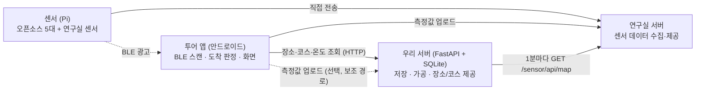
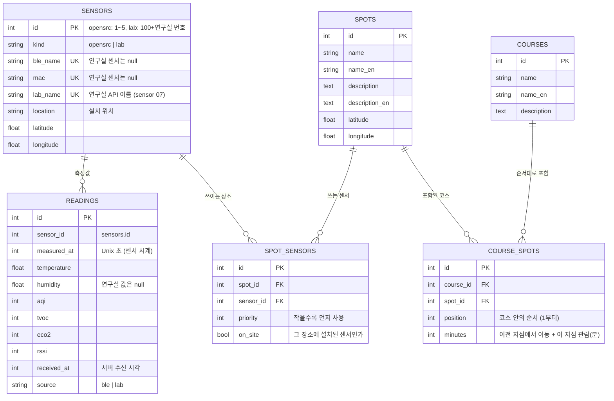
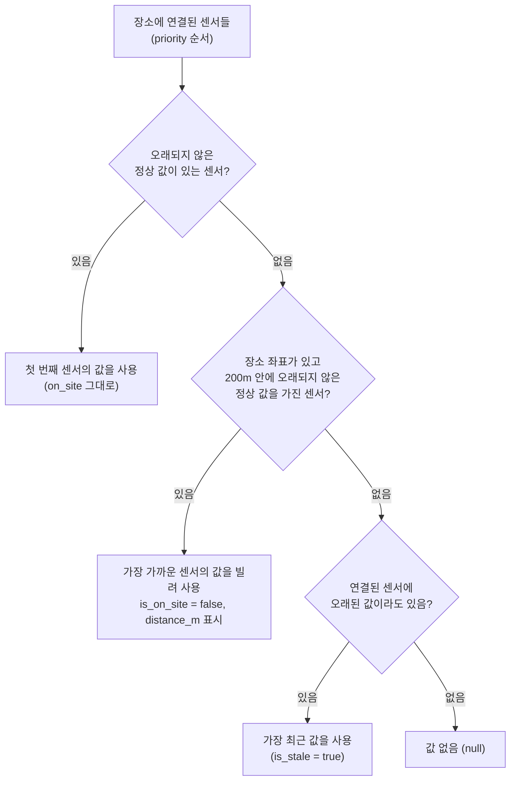

# 백엔드 설계 문서 (초안)

캠퍼스 BLE 투어 가이드 — 서버 및 DB 파트
작성 기준: 2026-11-17 / 담당: 최세원

> 이 문서는 서버(백엔드)의 구조와 API를 정리한 초안입니다. 표 구조와 장소·센서 응답 예시는 실제 코드를 돌려서 뽑았고, 장소와 코스 값은 개발용 샘플입니다. (서버가 실제로 켜질 때 넣는 투어 데이터는 `app/tour_data.py`입니다.) 연구실 동기화 결과 예시의 숫자는 설명용입니다.

## 1. 개요

### 서버가 하는 일
- 캠퍼스 센서의 **온도를 모아서 저장**하고, 오래된 값이나 오류값을 걸러서 **믿을 수 있는 값으로 가공**합니다.
- 투어 앱에 **장소와 코스 정보, 장소별 현재 온도와 출처**를 제공합니다.
- 장소의 센서가 죽어 있으면 **가까운 센서의 값을 빌려** 보여줍니다.
- 지금 기온이 춥거나 더우면 짧은 코스를, 쾌적하면 긴 코스를 **추천**합니다.

### 범위
| 포함 | 포함하지 않음 |
| --- | --- |
| 센서 값 수집(연구실 API, 앱 업로드), 저장, 가공 | BLE 스캔과 도착 판정 (앱이 폰 안에서 처리) |
| 장소, 코스, 센서 정보 제공 API, 기온에 맞는 코스 추천 | 화면 (프론트엔드) |
| 센서 상태 점검 API | 방문 기록 저장 (개인정보 방침상 기기 안에만 저장) |

## 2. 시스템 구성



- **센서 데이터의 주 경로**: 센서 → 연구실 서버 → 우리 서버(1분마다 가져와 저장). 연구실 서버가 응답하지 않아도 우리 DB에 저장된 마지막 값을 보여줍니다.
- 연구실 API는 **온도(정수, 소수점 버림)와 CO2만** 주고 습도는 없습니다. 화면에는 온도만 표시합니다.
- 앱이 BLE로 읽은 값(습도, 공기질 포함)을 우리 서버에 직접 올리는 경로는 **보조**입니다.
- 앱은 BLE로 오픈소스 센서(`opensrc1~5`)의 신호 세기를 보고 도착을 판정합니다. 서버는 어느 센서가 어느 장소의 것인지(`arrival`)만 알려줍니다.

## 3. 기술 스택

| 구분 | 사용 |
| --- | --- |
| 언어 | Python 3.10 이상 |
| 웹 프레임워크 | FastAPI (자동 API 문서 `/docs` 제공), uvicorn |
| DB | SQLite (SQLAlchemy 2). `DATABASE_URL` 로 다른 DB로 바꿀 수 있음 |
| 외부 호출 | httpx (연구실 API) |
| 테스트 | pytest (96개) |

## 4. 데이터 모델 (ERD)



### 표별 설명
| 표 | 설명 | 주요 규칙 |
| --- | --- | --- |
| `sensors` | 캠퍼스 센서. 우리 팀 오픈소스 센서 5대(`opensrc`)와 연구실 센서(`lab`) | `ble_name`, `mac`, `lab_name`은 각각 유일. 연구실 센서는 연구실 API에서 위치가 있는 것을 **자동 등록** |
| `readings` | 센서 측정값 | **(`sensor_id`, `measured_at`)이 유일** → 같은 값이 다시 와도 한 번만 저장(재전송에 안전). `sensor_id`는 `sensors.id`를 가리키지만 DB 외래키 제약은 걸지 않음 |
| `spots` | 투어 장소 | `latitude`, `longitude`는 가까운 센서를 찾을 때 쓰므로 없으면 센서를 빌리지 못함 |
| `spot_sensors` | 장소와 센서의 연결 (다대다) | 장소 하나가 센서를 여러 개 쓰고(우선순위 순), 센서 하나를 여러 장소가 쓸 수 있음. (`spot_id`, `sensor_id`)가 유일 |
| `courses` | 투어 코스 | |
| `course_spots` | 코스와 장소의 연결 (다대다) | (`course_id`, `position`)이 유일. 코스 총 소요시간은 `minutes`의 합 |

### 설계 이유
- **센서와 장소를 분리**했습니다. 센서가 죽거나 바뀌어도 장소 정보는 그대로 두고 연결만 바꿉니다. (센서 4·5를 테니스장 한 장소로 묶고, 센서가 없는 장소는 가까운 센서를 빌림)
- **측정값을 센서 기준으로 저장**합니다. 같은 센서의 값이 장소 여러 곳에서 쓰일 수 있기 때문입니다.
- **오류값도 버리지 않고 저장**합니다. 조회할 때만 걸러서, 센서 고장 원인을 나중에 확인할 수 있습니다.

## 5. 데이터 처리 규칙 (전처리)

| 규칙 | 내용 | 기본값 |
| --- | --- | --- |
| 중복 제거 | 같은 센서의 같은 `measured_at`은 한 번만 저장 | - |
| 오류값 제외 | 온도 -20~45도, 습도 0~100%를 벗어나거나 **온도와 습도가 모두 0.0**이면 저장하되 최신값·평균·고정값 판정에서 제외. 습도가 없는 값은 온도만 검사 | - |
| 오래된 값 표시 | 측정 후 기준 시간이 지나면 `is_stale`이 `true` | 30분 (`STALE_MINUTES`) |
| 고정값 의심 | BLE로 받은 값에서 최신 값과 같은 온도·습도가 **5개 이상 연속이고 10분 이상** 이어지면 `is_suspect`가 `true` (센서가 멈춘 것으로 의심). 연구실 값은 정수 온도라 적용하지 않음 | 5개, 10분 |
| 최근 평균 | 최근 30분 안의 정상 값의 평균(습도는 값이 있는 것만). 고정값 의심이면 `null` | 30분 |
| 센서 상태 | `no_data`(값 없음) > `invalid`(오류값만 옴) > `stale`(오래됨) > `suspect`(고정값 의심) > `ok` 순으로 우선 | - |

### 장소의 온도를 정하는 방법
장소마다 `latest_reading`(현재 온도)과 `value_source`(어느 센서의 값인가)를 다음 순서로 정합니다.



- 센서 4가 죽어 있으면 센서 4·5가 연결된 **테니스장은 센서 5의 값**을 씁니다.
- 센서 3이 죽어 있는 **이마트24 건너편은 56m 거리의 opensrc1 값**을 빌립니다. (실제 데이터로 확인)
- 최대 거리 200m는 `MAX_BORROW_METERS`로 바꿀 수 있습니다. 먼 센서는 그 장소의 온도라고 보기 어려워 쓰지 않습니다.

### 연구실 센서 가져오기 (동기화)
- 서버가 켜져 있는 동안 **1분마다** 연구실 API(`GET /sensor/api/map`)를 호출합니다.
- 1시간 이내에 갱신된 값(`fresh`)만 저장하고, 위치가 있는 센서는 `sensors`에 자동 등록합니다(`sensor 18` → id 118).
- 시각은 KST 문자열(`Tue Nov 10 07:09:55 2026`)이라 Unix 초로 변환합니다.
- 연구실 서버가 응답하지 않아도 서비스는 멈추지 않고, 마지막 결과는 `GET /api/lab-sync/status`로 확인합니다.

## 6. API 명세

### 공통
- 기본 주소: `http://서버주소:8000` (예: `http://172.30.159.219:8000`). 자동 문서는 `/docs`.
- 요청과 응답은 JSON이고 문자는 UTF-8입니다.
- 시각은 모두 **Unix 초**입니다.
- 인증은 없습니다. (프로젝트 범위상 공개 API)
- 오류 응답은 `{"detail": "..."}` 형식입니다. 본문 형식이 틀리면 `422`(자세한 위치 포함)입니다.

### 한눈에 보기
| 메서드 | 경로 | 설명 | 주요 응답 코드 |
| --- | --- | --- | --- |
| GET | `/health` | 서버 상태 확인 | 200 |
| GET | `/api/spots` | 장소 목록 + 도착 방식 + 현재 온도와 출처 | 200 |
| GET | `/api/spots/{id}` | 장소 상세 | 200, 404 |
| GET | `/api/courses` | 코스 목록, 장소 순서, 총 소요시간 | 200 |
| GET | `/api/courses/recommend` | 현재 기온에 맞는 코스 추천 | 200 |
| GET | `/api/sensors` | 등록된 센서 목록 (`?kind=opensrc` 또는 `lab`) | 200 |
| GET | `/api/sensors/status` | 센서별 상태 (`?kind=`) | 200 |
| GET | `/api/lab-sync/status` | 연구실 센서 가져오기의 마지막 결과 | 200 |
| POST | `/api/readings` | 앱이 BLE로 읽은 측정값 업로드 (보조 경로) | 201, 200, 404, 422 |

### GET /health
```json
{ "status": "ok" }
```

### GET /api/spots , GET /api/spots/{id}
장소와 현재 온도를 돌려줍니다. `/api/spots`는 이 객체의 배열입니다.

**응답 필드**
| 필드 | 설명 |
| --- | --- |
| `id`, `name`, `name_en`, `description`, `description_en` | 장소 정보 (영어는 없으면 `null`) |
| `latitude`, `longitude` | 장소 좌표. 모르면 `null` |
| `arrival.method` | `ble_auto`: 장소에 설치된 센서가 있어 BLE로 도착을 자동 판정(수동 버튼은 보조). `manual`: 센서가 없어 방문객이 "도착" 버튼으로 체크 |
| `arrival.sensors` | 도착 판정에 쓰는, 이 장소에 설치된 센서(`sensor_id`, `ble_name`, `mac`, `location`). `manual`이면 빈 목록. 앱이 스캔한 센서가 이 목록에 있으면 이 장소에 도착한 것 |
| `latest_reading` | 현재 온도. 값이 없으면 `null` |
| `latest_reading.temperature`, `humidity` | 온도(℃), 습도(%). 연구실 값은 습도가 `null`. 화면에는 온도만 표시 |
| `latest_reading.age_minutes`, `is_stale`, `is_suspect` | 측정 후 경과 시간(분), 오래된 값인가, 고정값 의심인가 |
| `recent_average` | 최근 평균. 값이 없거나 고정값 의심이면 `null` |
| `value_source` | `latest_reading`이 어느 센서의 값인가. 값이 없으면 `null` |
| `value_source.is_on_site` | `true`: 이 장소에 설치된 센서의 값, `false`: 가까운 센서 값을 빌려 쓴 것 |
| `value_source.distance_m` | 장소와 센서 사이 거리(m). 좌표를 모르면 `null`. "약 56m 떨어진 센서 기준" 표시에 사용 |
| `value_source.ble_name`, `lab_name`, `location` | 센서 이름과 설치 위치. 화면의 출처 문구에 사용 |

**예시: 센서 두 개를 묶은 장소 (GET /api/spots/4)**
```json
{
  "id": 4,
  "name": "테니스장",
  "name_en": "Tennis Courts",
  "description": "[샘플] 테니스장 앞과 건너편 길.",
  "description_en": null,
  "latitude": 36.6306005,
  "longitude": 127.455014,
  "arrival": {
    "method": "ble_auto",
    "sensors": [
      { "sensor_id": 4, "ble_name": "opensrc4", "mac": "D8:3A:DD:79:8F:80", "location": "테니스장 앞" },
      { "sensor_id": 5, "ble_name": "opensrc5", "mac": "D8:3A:DD:C1:89:5B", "location": "테니스장 건너편" }
    ]
  },
  "latest_reading": {
    "sensor_id": 4, "measured_at": 1794885338,
    "temperature": 24.0, "humidity": 54.0,
    "age_minutes": 2, "is_stale": false, "is_suspect": false
  },
  "recent_average": { "temperature": 24.0, "humidity": 54.0, "count": 1, "window_minutes": 30 },
  "value_source": {
    "sensor_id": 4, "ble_name": "opensrc4", "lab_name": "sensor 32",
    "location": "테니스장 앞", "is_on_site": true, "distance_m": 80
  }
}
```

**예시: 센서가 없는 장소 (GET /api/spots/5)** — 수동 도착 버튼, 가까운 센서 값을 빌린 경우
```json
{
  "id": 5,
  "name": "[샘플] 센서 없는 장소",
  "arrival": { "method": "manual", "sensors": [] },
  "latest_reading": { "sensor_id": 2, "temperature": 22.0, "humidity": 52.0, "age_minutes": 2, "is_stale": false, "is_suspect": false },
  "value_source": { "sensor_id": 2, "ble_name": "opensrc2", "lab_name": "sensor 15",
                    "location": "사회과학대 입구", "is_on_site": false, "distance_m": null }
}
```
(일부 필드는 생략했습니다. 이 샘플 장소는 좌표가 없어 `distance_m`이 `null`입니다.)

**오류**: 없는 장소 번호는 `404` `{"detail": "spot not found"}`

### GET /api/courses
코스 목록입니다. 코스마다 장소가 순서대로 들어 있고 각 장소는 위 장소 객체와 같습니다.

| 필드 | 설명 |
| --- | --- |
| `id`, `name`, `name_en`, `description` | 코스 정보 |
| `total_minutes` | 총 소요시간(분). 지점별 `minutes`의 합 |
| `spots[].position` | 코스 안의 순서 (1부터) |
| `spots[].minutes` | 이전 지점에서 이동 + 이 지점 관람 시간(분) |
| `spots[].spot` | 장소 객체 (위와 같음) |

```json
[
  {
    "id": 1, "name": "짧은 코스", "name_en": "Short Course",
    "description": "[샘플] 더위/추위에 추천하는 짧은 코스",
    "total_minutes": 25,
    "spots": [ { "position": 1, "minutes": 5, "spot": { "...": "장소 객체" } } ]
  }
]
```

### GET /api/courses/recommend
지금 기온에 맞는 코스를 골라 줍니다. 앱은 `recommended_course_id`와 `reason`을 그대로 쓰면 됩니다.

**판단 방법**
1. 모든 코스의 장소를 합쳐서(한 장소는 한 번만) 현재 기온을 모읍니다. 오래된 값(`is_stale`)은 쓰지 않습니다.
2. 센서가 없는 장소가 가까운 센서 값을 빌려 쓰면 여러 장소가 같은 센서 값을 갖게 되므로, **같은 센서의 값은 한 번만** 넣어 평균을 냅니다.
3. 평균 기온으로 상태를 나눕니다.

| 상태 `condition` | 기준 | 추천 코스 |
| --- | --- | --- |
| `cold` | `COLD_MAX_CELSIUS`(기본 5℃) 이하 | 소요시간이 가장 짧은 코스 |
| `hot` | `HOT_MIN_CELSIUS`(기본 27℃) 이상 | 소요시간이 가장 짧은 코스 |
| `comfortable` | 그 사이 | 소요시간이 가장 긴 코스 |
| `unknown` | 기온을 아는 장소가 없음 | 가장 긴 코스(기본 코스) |

길이가 같으면 번호가 작은 코스입니다. 코스가 하나도 없으면 `recommended_course_id`는 `null`입니다.

| 필드 | 설명 |
| --- | --- |
| `condition` | 위 표의 상태 |
| `temperature` | 판단에 쓴 평균 기온(℃). 알 수 없으면 `null` |
| `sample_count` | 평균에 쓴 값의 수 (같은 센서는 한 번만 셈) |
| `thresholds` | 이 서버가 쓰는 기준 (`cold_max`, `hot_min`) |
| `recommended_course_id`, `recommended_course_name` | 추천 코스 |
| `reason` | 화면에 그대로 보여줄 수 있는 추천 이유 문장 |
| `courses[]` | 모든 코스의 `id`, `name`, `total_minutes`, `average_temperature`(그 코스의 장소만으로 구한 평균), `recommended` |

```json
{
  "condition": "comfortable",
  "temperature": 22.5,
  "sample_count": 4,
  "thresholds": { "cold_max": 5, "hot_min": 27 },
  "recommended_course_id": 2,
  "recommended_course_name": "기본 코스",
  "reason": "기온 22.5도로 활동하기 좋아 가장 긴 코스(기본 코스)를 추천합니다.",
  "courses": [
    { "id": 1, "name": "짧은 코스", "total_minutes": 25, "average_temperature": 22.3, "recommended": false },
    { "id": 2, "name": "기본 코스", "total_minutes": 45, "average_temperature": 22.5, "recommended": true }
  ]
}
```

### GET /api/sensors
등록된 센서 목록입니다. `?kind=opensrc` 또는 `?kind=lab`으로 거를 수 있습니다.

```json
{
  "sensor_id": 1, "kind": "opensrc",
  "ble_name": "opensrc1", "mac": "88:A2:9E:9B:5F:09",
  "location": "도서관 뒤편 (진로창업본부 입구)", "lab_name": "sensor 07",
  "latitude": 36.628895, "longitude": 127.457839
}
```
연구실 센서(`kind: lab`)는 `ble_name`, `mac`이 `null`이고 `sensor_id`는 100 + 연구실 번호입니다.

### GET /api/sensors/status
센서별 상태입니다. 통합 테스트와 시연 전 점검에 사용합니다. `?kind=`로 거를 수 있습니다.

```json
{
  "sensor_id": 1, "kind": "opensrc", "ble_name": "opensrc1",
  "mac": "88:A2:9E:9B:5F:09", "location": "도서관 뒤편 (진로창업본부 입구)",
  "spot_names": ["도서관 뒤편"],
  "status": "ok",
  "latest_reading": { "sensor_id": 1, "temperature": 24.1, "humidity": 48.0, "age_minutes": 0, "is_stale": false, "is_suspect": false },
  "last_received_at": 1794885458
}
```

| `status` | 의미 |
| --- | --- |
| `ok` | 최근 값이 들어오고 있음 |
| `stale` | 마지막 측정이 오래됨 |
| `suspect` | 최근 값이 계속 같음 (센서 멈춤 의심) |
| `invalid` | 값은 오지만 전부 오류값 (범위 밖이거나 온도·습도가 모두 0.0) |
| `no_data` | 등록되었지만 값을 받은 적 없음 |

`spot_names`는 이 센서를 쓰는 모든 장소(설치된 곳과 빌려 쓰는 곳)입니다. `last_received_at`은 서버가 값을 받은 시각이며 측정 시각과 크게 다르면 센서 시계가 틀렸을 수 있습니다.

### GET /api/lab-sync/status
연구실 센서 가져오기의 마지막 결과입니다.

```json
{
  "enabled": true, "interval_seconds": 60,
  "url": "http://203.255.81.72:10021/sensor/api/map",
  "last_attempt": 1794885400, "last_success": 1794885400, "last_error": null,
  "last_result": { "fetched": 36, "new_sensors": 0, "unknown_sensor": 0,
                   "not_fresh": 24, "invalid": 0, "duplicate": 12, "stored": 0 }
}
```
연결이 안 되면 `last_error`에 원인이 나옵니다.

### POST /api/readings
앱이 BLE로 읽은 값을 올립니다. (연구실 서버로 올리는 것이 주 경로이고 이쪽은 보조입니다.)

**요청 본문**
| 필드 | 필수 | 설명 |
| --- | --- | --- |
| `ble_name` | O | BLE 광고 이름 (1~50자, 예: `opensrc1`) |
| `mac` | | 센서 MAC. iOS는 알 수 없어 생략 가능. 소문자·하이픈도 같은 MAC으로 처리 |
| `measured_at` | O | 패킷의 측정 시각 (Unix 초, 0 이상) |
| `temperature` | O | ℃ (앱이 x100 정수를 실수로 풀어서 보냄) |
| `humidity` | O | % |
| `aqi`, `tvoc`, `eco2` | | 공기질 (0~255, 0~65535, 0~65535). 서버에는 저장만 함 |
| `rssi` | | 폰이 받은 신호 세기 (-127~20 dBm) |

```json
{
  "ble_name": "opensrc1", "mac": "88:A2:9E:9B:5F:09",
  "measured_at": 1790600000, "temperature": 24.1, "humidity": 48.0,
  "aqi": 2, "tvoc": 90, "eco2": 620, "rssi": -58
}
```

**센서 찾기**: `mac`이 있으면 MAC으로만 찾습니다(MAC이 다르면 이름이 같아도 다른 기기일 수 있어 거절). `mac`이 없으면 `ble_name`으로 찾습니다.

**응답**
| 코드 | 본문 | 의미 | 앱 동작 |
| --- | --- | --- | --- |
| 201 | `{"status": "created"}` | 새로 저장 | 성공 |
| 200 | `{"status": "duplicate"}` | 같은 센서의 같은 `measured_at`이 이미 있음. 먼저 저장된 값을 유지 | 성공으로 처리 |
| 404 | `{"detail": "등록되지 않은 센서입니다"}` | 등록되지 않은 센서 | 재시도하지 않음 |
| 422 | 오류 위치 목록 | 본문 형식 오류 (필수 필드 누락, MAC 형식 등) | 재시도하지 않음 |

온도 -20~45도, 습도 0~100%를 벗어난 값은 거절하지 않고 **저장한 뒤 오류값으로 제외**합니다. (앱의 재전송이 같은 요청을 반복하지 않게 하기 위함)

## 7. 설정 (환경변수)

| 이름 | 기본값 | 설명 |
| --- | --- | --- |
| `DATABASE_URL` | `sqlite:///./campus_tour.db` | DB 주소 |
| `LAB_SYNC_ENABLED` | 1 | 연구실 센서 가져오기 켜기·끄기 |
| `LAB_SYNC_URL` | `http://203.255.81.72:10021/sensor/api/map` | 연구실 센서 API |
| `LAB_SYNC_SECONDS` | 60 | 가져오는 간격(초) |
| `LAB_SYNC_TIMEOUT` | 10 | 요청 제한 시간(초) |
| `MAX_BORROW_METERS` | 200 | 가까운 센서 값을 빌려 쓰는 최대 거리(m) |
| `STALE_MINUTES` | 30 | 오래된 값으로 보는 기준(분) |
| `FIXED_VALUE_MIN_COUNT` | 5 | 고정값 의심의 같은 값 최소 연속 개수 |
| `FIXED_VALUE_MINUTES` | 10 | 같은 값이 이 시간(분) 이상 이어져야 고정값 의심 |
| `AVG_WINDOW_MINUTES` | 30 | 최근 평균의 시간 범위(분) |
| `COLD_MAX_CELSIUS` | 5 | 코스 추천에서 이 기온(℃) 이하면 춥다고 봄 |
| `HOT_MIN_CELSIUS` | 27 | 코스 추천에서 이 기온(℃) 이상이면 덥다고 봄 |

설정 예시는 저장소의 `.env.example`, 서버를 켜는 방법은 `README.md`의 "서버 열기"에 있습니다.

## 8. 테스트

pytest 119개가 통과합니다. (`pytest` 한 줄로 실행)

| 영역 | 확인하는 것 |
| --- | --- |
| 업로드 API | 센서 찾기(MAC, 이름), 중복 제거, 미등록 센서 404, 범위 밖 값 저장 후 제외, 공기질·RSSI 저장 |
| 전처리 | 오류값, 오래됨, 고정값(개수와 시간 조건), 평균(습도 없는 값 포함), 센서 상태 우선순위 |
| 연구실 동기화 | 시각(KST) 변환, 이름 정규화, fresh 값만 저장, 중복·미래 시각·누락 필드 처리, 센서 자동 등록, 연구실 서버 장애 시 동작 |
| 장소와 센서 | 센서 여러 개 묶기와 우선순위, 값의 출처, 도착 방식, 코스 응답 |
| 가까운 센서 빌리기 | 200m 기준, 가장 가까운 정상 센서 선택, 오래된 이웃 제외, 좌표 없는 장소, 연구실 센서 빌리기 |
| 코스 추천 | 춥다·덥다·쾌적·알 수 없음 기준(경계값 포함), 가장 짧은/긴 코스 선택과 동점 처리, 평균에서 같은 센서 한 번만 세기, 오래된 값 제외, 코스가 없을 때 |
| 설정 | `.env.example`이 실제 설정·기본값과 일치 |

## 9. 제한과 미정 사항

| 항목 | 내용 |
| --- | --- |
| 장소와 코스 | 서버는 실제 투어 12곳, 코스 3개(`app/tour_data.py`, 이슈 #22)로 켜집니다. 이 문서의 응답 예시는 개발용 샘플(`app/seed.py`) 기준이라 이름과 값이 다릅니다. 코스 이름은 팀 확정 전입니다. |
| 호스팅 | 서버를 올릴 곳은 미정. 발표와 시연은 노트북에서 켜서 같은 Wi-Fi로 접속하는 방향 |
| 연구실 서버 의존 | 센서 값은 연구실 API에 의존. 응답이 없을 때를 대비해 DB에 저장하지만, 호출 제한과 장기 안정성은 확인하지 못함 |
| 센서 상태 | 오픈소스 센서 3, 4는 값이 없고 연구실 센서는 일부(예: 12종)만 갱신 중. 가까운 센서 값을 빌려 보완 |
| 습도 | 연구실 API에 없어서 화면에는 온도만 표시 |
| DB 변경 | 마이그레이션 도구 없이 표 구조가 바뀌면 DB 파일을 지우고 다시 만듦 (예전 구조를 감지하면 안내 메시지로 멈춤) |
| 보안 | 인증 없음. 서버에는 센서 값만 저장하고 폰 위치와 기기 ID는 저장하지 않음 |
| 코스 추천 기준 | 5℃ 이하, 27℃ 이상을 기본값으로 정했을 뿐 실험으로 정한 값은 아님. 환경변수로 바꿀 수 있음 |
| 선택 기능 | 이동 시간 자동 계산은 미구현 (장소 좌표 확정 후, 이슈 #22). 기상청 날씨 대체는 보류하고 이슈 #18을 닫음 |
